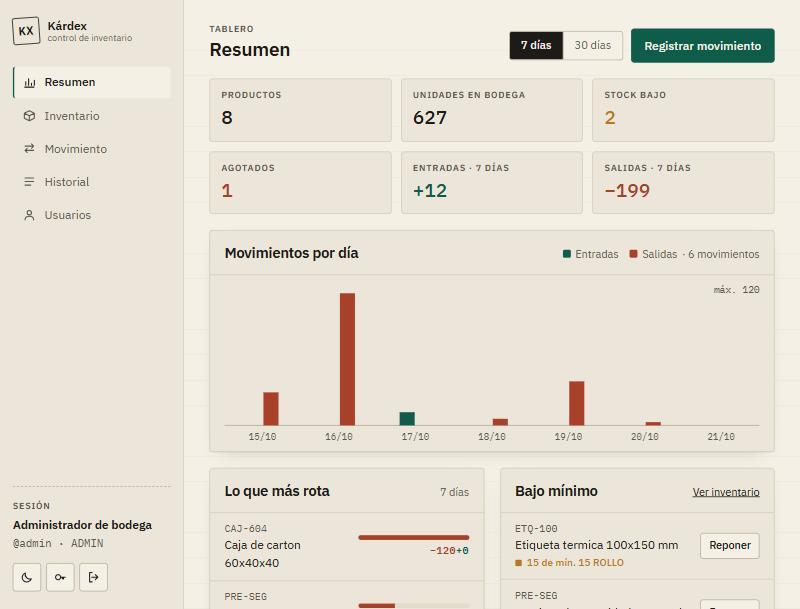
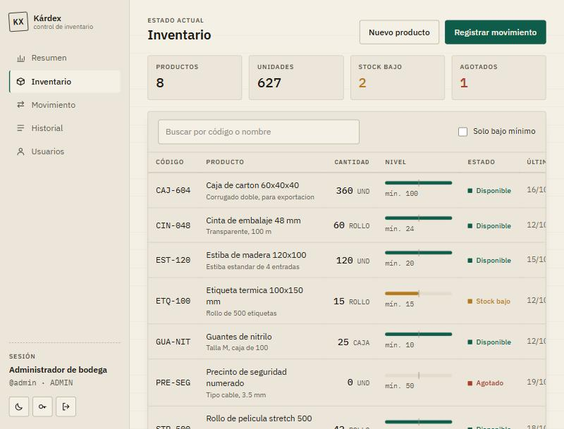
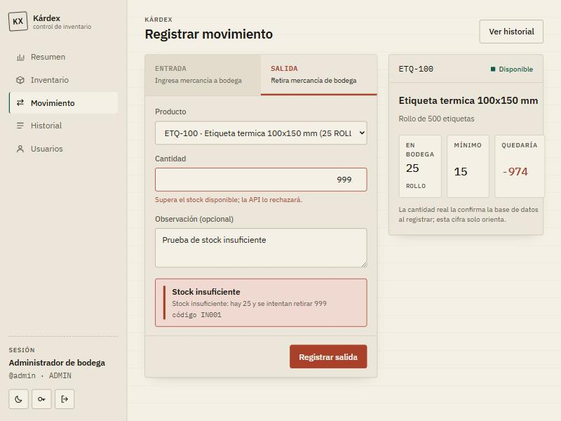
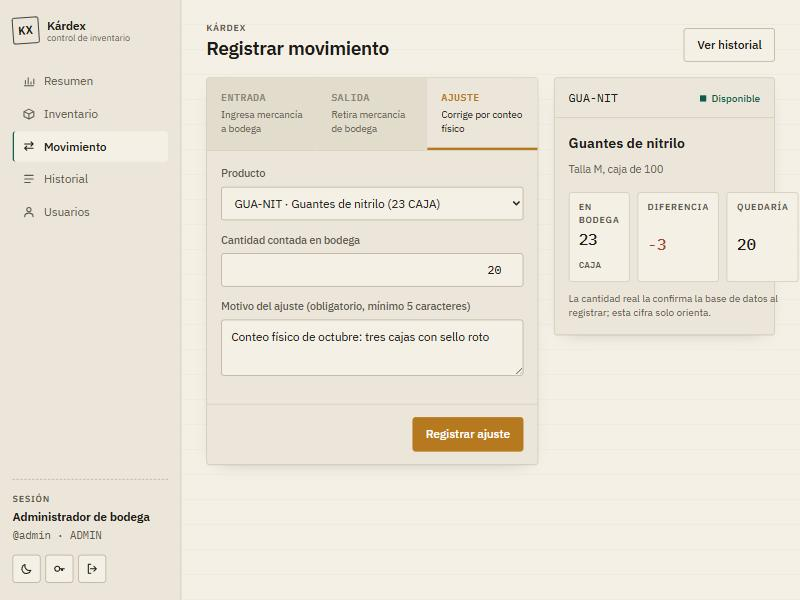
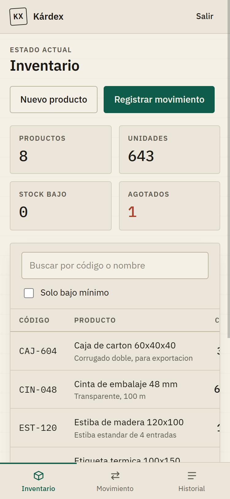
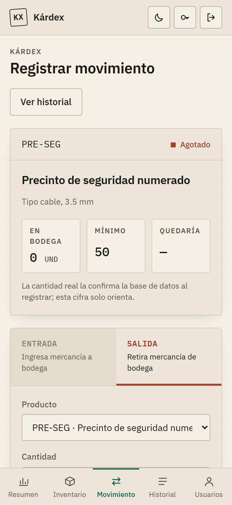

# Kárdex · mini sistema de gestión de inventario

Aplicación web para registrar entradas y salidas de productos y consultar el inventario actual.
La lógica de negocio vive en **procedimientos almacenados de PostgreSQL**; la API en C# los invoca
con Dapper y el frontend en Angular consume la API con autenticación JWT.

| Capa | Tecnología |
| --- | --- |
| Base de datos | PostgreSQL 16 · tablas, procedimientos (`CALL`) y funciones (`RETURNS TABLE`) |
| Backend | .NET 10 · ASP.NET Core Web API · Dapper · Npgsql · JWT Bearer · Swagger · xUnit |
| Frontend | Angular 22 (standalone, signals, zoneless) · TypeScript · CSS propio, responsive y con tema claro/oscuro |

```text
mini-inventario/
├── database/inventario.sql        # esquema + procedimientos + funciones + datos iniciales
├── backend/
│   ├── Inventario.Api/            # API REST
│   └── Inventario.Api.Tests/      # pruebas xUnit (API y procedimientos)
├── frontend/                      # aplicación Angular
├── docs/capturas/                 # capturas de pantalla
└── docker-compose.yml             # PostgreSQL local con el script ya aplicado
```

## Cómo ejecutarlo

Requisitos: Docker (o PostgreSQL 16), .NET SDK 10 y Node.js 20+.

**1. Base de datos.** Con Docker, el script se aplica solo la primera vez:

```bash
docker compose up -d
```

Sin Docker: crea una base y ejecuta `database/inventario.sql` con `psql -U <usuario> -d <base> -f database/inventario.sql`.
El script es re-ejecutable (hace `DROP ... IF EXISTS` al inicio) y necesita la extensión `pgcrypto`, incluida en PostgreSQL.

**2. API.** Queda en `http://localhost:5148` y abre Swagger en la raíz.

```bash
cd backend/Inventario.Api
dotnet run
```

La cadena de conexión y la clave JWT de desarrollo están en `appsettings.Development.json`
(apuntan a la base de `docker-compose.yml`). En otro ambiente se pasan por variables de entorno:
`ConnectionStrings__Inventario` y `Jwt__Clave`.

**3. Frontend.** Queda en `http://localhost:4200`.

```bash
cd frontend
npm install
npm start
```

**Credenciales de prueba:** `admin` / `admin123` (rol ADMIN) y `operador` / `Operador123` (rol OPERADOR).

## Base de datos

### Tablas

- `productos`: código único, nombre, unidad, stock mínimo y **cantidad** (con `CHECK (cantidad >= 0)` como última barrera).
- `movimientos`: tipo (`ENTRADA` | `SALIDA` | `AJUSTE`), cantidad, usuario, observación y **stock_resultante**, la
  foto del stock justo después del movimiento, como en una tarjeta de kárdex. En un ajuste, `cantidad` guarda la
  diferencia con signo entre lo contado y lo que había.
- `usuarios`: nombre de usuario, clave en bcrypt, rol (`ADMIN` | `OPERADOR`) y la marca `debe_cambiar_clave`
  que obliga a cambiar una clave temporal en el siguiente ingreso.

### Procedimientos y funciones

| Objeto | Tipo | Qué hace |
| --- | --- | --- |
| `sp_registrar_entrada(producto, cantidad, usuario, observacion, INOUT id, INOUT stock)` | PROCEDURE | Suma al stock e inserta el movimiento. |
| `sp_registrar_salida(...)` | PROCEDURE | Valida que haya stock suficiente; si no, `RAISE EXCEPTION` con SQLSTATE `IN001`. Descuenta e inserta el movimiento. |
| `sp_registrar_ajuste(producto, cantidad_contada, usuario, motivo, INOUT id, INOUT diferencia, INOUT stock)` | PROCEDURE | Ajuste por conteo físico: calcula la diferencia contra el stock registrado, exige motivo y rechaza un conteo igual al stock (`IN003`). |
| `sp_crear_producto(...)` | PROCEDURE | Crea el producto; si trae cantidad inicial la registra como ENTRADA. |
| `fn_inventario_actual(busqueda, solo_bajo)` | FUNCTION `RETURNS TABLE` | Inventario actual con estado `DISPONIBLE`, `BAJO` o `AGOTADO`. |
| `fn_historial_movimientos(producto, tipo, limite, desplazamiento)` | FUNCTION `RETURNS TABLE` | Historial paginado con el total de filas (`COUNT(*) OVER ()`). |
| `sp_crear_usuario(...)`, `sp_cambiar_estado_usuario(...)`, `sp_cambiar_clave(...)`, `sp_restablecer_clave(...)` | PROCEDURE | Gestión de usuarios (extra). Reciben el hash, nunca la clave en claro. |
| `fn_usuarios()` | FUNCTION `RETURNS TABLE` | Usuarios con rol, estado y cuántos movimientos registraron. |
| `fn_resumen_inventario(dias, zona)`, `fn_movimientos_por_dia(dias, zona)`, `fn_productos_mas_movidos(dias, limite, zona)` | FUNCTION `RETURNS TABLE` | Datos del tablero (extra): cifras del período, serie diaria sin huecos (`generate_series`) y productos que más rotan, agrupando por día en la zona horaria del cliente. |

**Por qué las lecturas son funciones y no procedimientos.** En PostgreSQL un `PROCEDURE` se invoca con
`CALL` y no devuelve un conjunto de filas; para consultar datos se usa una función con `RETURNS TABLE`,
que se consume con un `SELECT * FROM fn_...()` y acepta filtros, `WHERE` y paginación. Los procedimientos
quedan para las operaciones que escriben (entradas, salidas, alta de producto).

**Una sola transacción.** Cada procedimiento actualiza `productos` e inserta en `movimientos` dentro de la
misma transacción: si cualquiera de los dos pasos falla, no queda nada a medias.

**`FOR UPDATE`.** Antes de validar el stock, el procedimiento bloquea la fila del producto. Dos salidas
simultáneas del mismo producto se serializan: la segunda espera, lee el stock ya descontado y, si no
alcanza, falla. Hay una prueba de concurrencia que lo comprueba.

**Errores con código propio.** Los procedimientos lanzan excepciones con SQLSTATE propio, y la API los
traduce por código en vez de leer el texto del mensaje:

| SQLSTATE | Significado | Respuesta HTTP |
| --- | --- | --- |
| `IN001` | Stock insuficiente | 409 Conflict (incluye `stock.disponible` y `stock.solicitado`) |
| `IN002` | Producto no existe o está inactivo | 404 Not Found |
| `IN003` | Cantidad o datos inválidos | 400 Bad Request |
| `IN004` | Usuario no existe o está inactivo | 404 Not Found |
| `IN005` | Regla de usuarios: desactivarse a sí mismo, desactivar al último ADMIN, restablecer la clave propia | 409 Conflict |
| `23505` | Código de producto o nombre de usuario repetido (UNIQUE) | 409 Conflict |

## API

Todas las rutas menos el login exigen `Authorization: Bearer <token>`. Swagger (`/swagger`) tiene el
botón *Authorize* para probarlas.

| Método y ruta | Descripción |
| --- | --- |
| `POST /api/auth/login` | Devuelve el JWT (8 h) con el usuario en las claims. |
| `GET /api/productos?busqueda=&soloBajo=` | Inventario actual (`fn_inventario_actual`). |
| `GET /api/productos/{id}` | Un producto. |
| `POST /api/productos` | Crea un producto (`sp_crear_producto`). Responde 201. |
| `POST /api/movimientos/entradas` | Registra una entrada (`sp_registrar_entrada`). Responde 201 con el stock resultante. |
| `POST /api/movimientos/salidas` | Registra una salida (`sp_registrar_salida`). 409 si no hay stock. |
| `POST /api/movimientos/ajustes` | Solo ADMIN: ajuste por conteo físico (`sp_registrar_ajuste`). Responde la diferencia calculada y el stock resultante. |
| `GET /api/movimientos?productoId=&tipo=&pagina=&tamano=` | Historial paginado (`fn_historial_movimientos`); `tipo` admite ENTRADA, SALIDA o AJUSTE y cada fila trae la diferencia con signo. |
| `GET /api/auth/sesion` | Datos del usuario del token leídos de la base; valida la sesión al abrir la aplicación. |
| `POST /api/auth/cambiar-clave` | Cambia la clave propia (pide la actual) y devuelve un token nuevo. |
| `GET /api/usuarios` · `POST /api/usuarios` | Solo ADMIN: lista y crea usuarios con clave temporal. |
| `PATCH /api/usuarios/{id}/estado` | Solo ADMIN: activa o desactiva. |
| `POST /api/usuarios/{id}/restablecer-clave` | Solo ADMIN: asigna una clave temporal a otro usuario. |
| `GET /api/resumen?dias=&zona=` | Tablero: cifras, movimientos por día, más movidos, bajo mínimo y últimos movimientos en una sola respuesta. |
| `GET /salud` | Comprueba la conexión con la base. |

Decisiones del backend:

- **Dapper en lugar de EF Core.** Como toda la lógica está en procedimientos, no hay entidades que
  rastrear ni consultas LINQ: cada método del repositorio es un `CALL` o un `SELECT ... FROM fn_...`.
  Los parámetros `INOUT` del procedimiento vuelven como una fila que Dapper lee en una tupla.
- **Errores uniformes.** Un middleware convierte las `PostgresException` en respuestas
  `application/problem+json` (RFC 9457) con título, detalle y el código; los errores no previstos salen
  como 500 genérico sin filtrar detalles internos. Las validaciones de forma (rangos, longitudes) las
  hace ASP.NET con DataAnnotations antes de llegar a la base.
- **Seguridad.** Claves en bcrypt, JWT firmado con HMAC-SHA256 con emisor, audiencia y vigencia
  validados. El usuario que firma cada movimiento sale del token, nunca del cuerpo de la petición.
  El login compara contra un hash aunque el usuario no exista para no revelar nombres por tiempo de respuesta.
  Los secretos no van en `appsettings.json`: los de desarrollo están en `appsettings.Development.json`
  y en producción se inyectan por entorno.

### Usuarios, roles y claves (extra)

- **Dos roles.** `OPERADOR` registra movimientos y consulta; `ADMIN` además administra usuarios. El rol
  viaja como claim de rol en el JWT y los endpoints de usuarios llevan `[Authorize(Roles = "ADMIN")]`;
  un operador recibe 403.
- **Alta por el administrador** con una clave temporal. El hash bcrypt se calcula en la API y es lo
  único que llega al procedimiento `sp_crear_usuario`.
- **Cambio de clave propio.** Pide la clave actual, exige mínimo 8 caracteres y devuelve un token nuevo.
- **Clave temporal con cambio obligatorio.** Cuando un admin crea un usuario o le restablece la clave,
  el token que recibe ese usuario lleva la claim `clave_pendiente`. La política de autorización por
  defecto de la API rechaza con 403 cualquier petición que la traiga, salvo ver la sesión y cambiar la
  clave; el frontend hace lo mismo con una guarda de ruta. Así se cubre el "olvidé mi clave" sin montar
  correo: el admin asigna una temporal y el sistema obliga a reemplazarla.
- **Reglas en la base.** Nadie puede desactivarse a sí mismo ni desactivar al último ADMIN activo
  (`IN005`); el restablecimiento no sirve para la clave propia.
- **Límite conocido.** Un token sigue siendo válido hasta su vencimiento aunque el usuario sea
  desactivado después; la pantalla lo detecta al recargar porque `GET /api/auth/sesion` responde 401.
  Para revocar al instante haría falta una lista de tokens revocados o vigencias más cortas con refresh.

### Pruebas

```bash
cd backend
dotnet test
```

- `ManejoErroresMiddlewareTests`: la traducción SQLSTATE → HTTP, sin servidor ni base.
- `MovimientosApiTests`: la API completa en memoria con un repositorio falso: 401 sin token, 400 de
  validación, 404 de producto, 409 de stock, 409 de código repetido.
- `UsuariosApiTests`: roles (403 al operador), clave temporal (403 salvo cambiarla), cambio y
  restablecimiento de clave, alta con validaciones y nombre repetido.
- `ResumenApiTests`: forma de la respuesta del tablero y acotación del período.
- `AjustesApiTests`: 403 al operador, 400 por datos o por conteo igual al stock, diferencia calculada.
- `ProcedimientosPostgresTests`: contra PostgreSQL real (entrada, salida, IN001, IN002 y dos salidas
  concurrentes). Se omiten si no existe la variable `INVENTARIO_TEST_DB`:

```bash
INVENTARIO_TEST_DB="Host=localhost;Port=5434;Database=mini_inventario;Username=inventario;Password=inventario123" dotnet test
```

Frontend: `npm test` corre las pruebas con Vitest.

## Frontend

- **Login** con JWT guardado en `localStorage`; un interceptor agrega el token a cada petición y, si la
  API responde 401, cierra la sesión y vuelve al login conservando la ruta a la que se iba.
- **Resumen** (pantalla de inicio): cifras del inventario y del período, gráfico de entradas y salidas por
  día dibujado en SVG sin librerías, productos que más rotan, lista de bajo mínimo con acceso directo a
  reponer y últimos movimientos; período de 7 o 30 días. Los días se agrupan en la zona horaria del
  navegador, que viaja a la función de la base.
- **Rutas protegidas.** Ninguna pantalla abre por URL sin sesión (guarda `authGuard`); al abrir la
  aplicación se confirma el token contra la API. Con clave temporal solo se puede ir a "Cambiar clave"
  y la sección Usuarios solo existe para ADMIN (guardas `claveVigenteGuard` y `adminGuard`). La API
  repite esas comprobaciones: la guarda evita la pantalla, el 403 evita el dato.
- **Usuarios** (ADMIN): lista con rol, estado y movimientos registrados; alta con clave temporal;
  activar o desactivar; restablecer clave.
- **Inventario**: resumen (productos, unidades, en bajo, agotados), búsqueda que resuelve la base de
  datos, filtro "solo bajo mínimo", barra de nivel frente al mínimo y alta de productos.
- **Registrar movimiento**: entrada o salida, selector de producto con su stock, cantidad y observación.
  Muestra el stock que quedaría como orientación, pero la regla la aplica la base: si no alcanza, el 409
  de la API se muestra tal cual con su código.
- **Ajuste de inventario** (solo ADMIN): tercer segmento del mismo formulario. Se escribe lo contado en
  bodega y el motivo; la ficha anticipa la diferencia y la base la confirma. Sirve para mermas, roturas y
  errores de registro sin disfrazarlos de entrada o salida.
- **Historial**: paginado, con filtros por tipo y producto, saldo tras cada movimiento y usuario.
- **Responsive**: barra lateral en escritorio y pestañas inferiores en móvil.
- **Tema** claro u oscuro: por defecto sigue al sistema operativo; el botón sol/luna (login, barra
  lateral y barra superior móvil) lo alterna y la elección queda guardada en el navegador.

## Capturas

Tablero de inicio, con las cifras del período y el gráfico de entradas y salidas por día:



Inventario actual con el estado de cada producto y su nivel frente al mínimo:



Salida rechazada por la base de datos: el 409 llega con el mensaje del procedimiento y el código IN001:



Ajuste por conteo físico (solo ADMIN): la ficha anticipa la diferencia antes de enviar:



Vista en móvil del inventario y del registro de movimiento:

<p>
  
  
</p>

Las demás (login, entrada registrada, historial, usuarios y cambio de clave obligatorio) están en
[`docs/capturas`](docs/capturas). La interfaz sigue el tema del
sistema, por eso hay capturas en claro y en oscuro.
